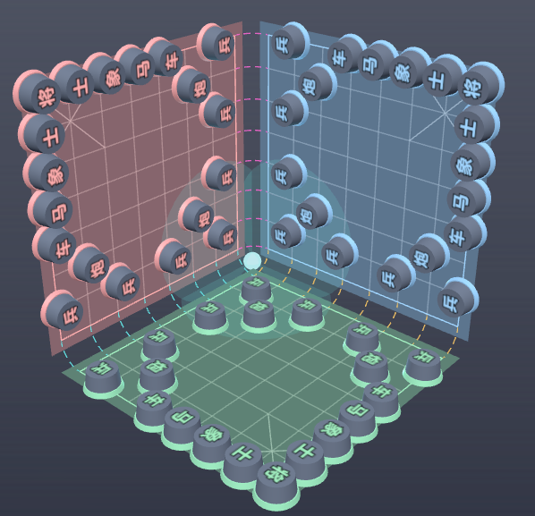

# 三维三人象棋｜设计文档
> Language: 中文 | [English](readme.en.md)
> 版本：V0.1.0
> 简介：3 块互相垂直的 **8×8** 正交棋盘平面，板间界河；连通轴线（AXIS_COL=0）上的棋子可经虚线弧跨河：车、炮、兵沿连续通道直行，马走三维跨平面日；三方 FFA 自由混战。
> 文档用途：规则定义、Demo（index.html / index-2d.html）开发与对局说明。

## 目录
1. 棋盘几何与结构
2. 全局基础铁律
3. 棋子定义与走子完整规则
4. 回合、将军、吃子、出局与胜负规则
5. 开局布局
6. 术语表
7. Demo 实现说明
8. 待决问题

---

## 1. 棋盘几何与结构
### 1.1 三个正交平面
- XY 平面：红方原生棋盘
- XZ 平面：蓝方原生棋盘
- YZ 平面：黄方原生棋盘

每块棋盘为 **8×8** 网格（`col, rank ∈ [0,7]`），三块板互不相接：板缘与坐标面之间留缝隙（GAP=0.71，界河宽≈1 格）。三块板的 **(0,0) 角隔河相望于原点**，原点处为**中心枢纽**（青色球体，三河交汇处）。

网格：
- 棋盘内的网格线，红色、蓝色棋盘相互朝向的网格为紫色，即为紫色连续通道；
- 棋盘内的网格线，红色、黄色棋盘相互朝向的网格为橙色，即为橙色连续通道；
- 棋盘内的网格线，蓝色、黄色棋盘相互朝向的网格为绿色，即为绿色连续通道；


- 品紫色虚线弧：X 轴河（红↔蓝）
- 橙色虚线弧：Y 轴河（红↔黄）
- 绿色虚线弧：Z 轴河（蓝↔黄）

> 实线为平面网格，虚线弧为中心过渡弯道。

### 1.2 棋盘河界线与界河（AXIS_COL=0）
- **棋盘河界线 = 各板内缘 0 号线（`col=AXIS_COL=0` 的纵线与 `rank=AXIS_COL=0` 的横线）**，即紧贴界河的两条内缘网格线（渲染中加亮显示）。
- 每条网格线经虚线弧与相邻棋盘的对应线连成**一条连续通道**（对面的线与本线视为同一条线）：
  - 红板 rank0 线 ↔ 蓝板 rank0 线（col c ↔ col c）
  - 红板 col0 线 ↔ 黄板 rank0 线（rank r ↔ col r）
  - 蓝板 col0 线 ↔ 黄板 col0 线（rank r ↔ rank r）

### 1.3 跨平面前提
车、炮、马、兵有跨河移动能力，其他棋子不能跨河移动：
- 车/炮：可沿着任何一条连续通道直行；
- 马：在棋盘河界线上可走三维跨平面日（见 §3.4）；
- **兵踏入任意对方棋盘河界线即判定过河**，同时获得跨河（跨平面）移动资格与横移能力（见 §3.5）。


---

## 2. 全局基础铁律（不可修改）
1. ❌ **禁止跨平面将军**：只有棋子和敌方【将】处于**同一个平面**，攻击才对主将生效；跨平面棋子无法威胁其它平面主将。
2. ❌ 将、士、象 **锁死原生平面**，不能跨平面。
3. ⚔️ FFA 自由混战，无强制结盟，玩家可临时合作、随时背刺。
4. 目标格是敌方普通棋子时可吃子。

---

## 3. 棋子定义与走子完整规则
> 棋子类型：将、士、象(相)、马、车、炮、兵

### 3.1 将 / 士 / 象
1. 仅在自家原生平面内活动；将、士活动于**角隅九宫 [5,7]×[5,7]**（棋盘远离枢纽的外角）将可以沿角隅九宫 内“田”字和“米”字随意移动士只能沿网格移动，不可沿米字移动，与传统走法有所差异。
2. **象**：田字步、塞象眼；**不能踏入连通轴线（col=0 或 rank=0）**——即传统"不能过河"的角隅版，天然不能跨平面。
3. 将、士、象永远无法跨河。

### 3.2 车
1. 平面内部：传统车，沿网格横竖直行，不能越子。
2. 踏上连通轴线后：沿整条连续通道（实线+虚线弧）一次性直行跨河，整段算作一步棋；一步只能沿单根同色通道，不能中途换线转弯；路径上有棋子阻挡则不能越过（通道上遇到子：可吃敌子/被阻挡）。

### 3.3 炮
1. 移动规则和车完全一致，沿连续通道可跨河长距离移动。
2. 吃子规则：沿通道，炮与目标之间**恰好隔 1 枚炮架**；炮架可在任意平面（含跨河段对岸）。

### 3.4 马（重点）
两种走法都算作合法，一步完成、不拆分回合：
1. **二维日**（任意位置）：平面内传统日字，蹩马腿只看出发表。
2. **三维跨平面日（弧线展开日）**：仅当马站在**棋盘河界线**上时可用，由本棋盘河界线和网格线、虚线弧线、对方棋盘河界线和网格线等，可以组成三维跨平面日，可以走动。
> ✅ 蹩马腿判定：只检查**出发表面**上与跨河方向垂直的相邻点 (c±1, 0)（或 (0, r±1)）；被挡则该方向的两个三维日均不可用。到达面无额外判定。
> 落子：不能落在友子；可吃普通敌方棋子，不能跨平面（棋盘）落在对方“将”上。

### 3.5 兵（重点）
1. **未过河（未踏上对方棋盘河界线）**：只能朝枢纽方向前进（-col 或 -rank，L 形前进），每步一格，不能横移。
2. **踏入其他两方棋盘河界线**：判定过河（**持久状态** `isExiled`，此后永久保持），获得：
   - 横移能力：沿 col+rank 等值线侧移（(1,-1) / (-1,1)），**永不回退**；
   - 跨河资格：继续前进即经弧跨入相邻棋盘。
3. **过河（离乡）**：一旦跨出原生平面，打上 `isExiled` 标记，**永久禁止返回原生平面**，只能在另外两个对手平面之间穿梭；离乡兵视为已过河，在敌方平面内保持横移能力。
4. 在敌方平面内：前进方向以当前所在平面为准（始终朝该板枢纽角 (0,0)）。

---

## 4. 回合、将军、吃子、出局与胜负规则
### 4.1 回合顺序
红(XY) → 蓝(XZ) → 黄(YZ)，循环。玩家出局后自动跳过。

### 4.2 将军判定
1. 只有**同平面**内棋子攻击才能产生将军；跨平面棋子无法将军其他平面主将。
2. 被将军方轮到时必须解将；走完后仍处于被将军状态的走法非法（送将不允许）。
3. 被将死者输掉游戏退出，他的兵、马、车、炮，归将军者，将、士、相棋子拔掉，由将军者继续统领。剩余2家继续游戏，**剩余两家中出现将军时，将军方即最终获胜**。

### 4.3 吃子规则
1. 普通吃子：终点格有敌方普通棋子则移动并移除。
2. 炮吃子：必须满足炮架条件（炮架可跨河）。
3. 吃对方**将**即**将军**。

### 4.4 无子可走
轮到某方且**未被将军**但没有任何合法走法 → **跳过该回合**（对局继续）。

### 4.5 出局判定
本方【将】被将军，且**没有任何合法应将走法**（将死）→ 立即出局。
> 出局效果：该玩家**兵、马、车、炮，归将军者，将、士、相棋子拔掉**。

### 4.6 胜利条件
对局持续到场上**仅剩一名存活玩家**，该玩家获胜；若同时无法判定则平局。

---

## 5. 开局布局（8×8 角隅布阵）
三家布局完全相同，各自位于原生平面。全军群于 **(7,7) 角**（远离枢纽的外角），沿 col7/rank7 两翼排底线，兵炮朝中心枢纽 (0,0) 推进。**开局没有棋子落在棋盘河界线上**。

| 线路 | 布子（col, rank） |
| ---- | ---- |
| 底线（L 形两翼，9 子） | 车(7,3) 马(7,4) 象(7,5) 士(7,6) **将(7,7)** 士(6,7) 象(5,7) 马(4,7) 车(3,7) |
| 炮 ×3 | 边炮 (6,2)、(2,6)——分别在兵 (5,1)、(1,5) **正后方 1 步**；中路口炮 (3,3)——在兵 (1,1) 之后，与边炮不在同一直线，避免开局即被吃掉 |
| 兵 ×7（L 形前线） | (7,1) (5,1) (3,1) (1,1) (1,3) (1,5) (1,7)——col1 与 rank1 上每隔一路一位 |

- 每家 **19 枚**：1 将 + 2 士 + 2 象 + 2 马 + 2 车 + 3 炮 + 7 兵；全场 **57 枚**。
- 布阵用意：边炮藏于兵后、中炮有兵屏障，避免"开局炮互啃无钳制"。
- 布置图参考：。

---

## 6. 术语表
| 术语 | 说明 |
| ---- | ---- |
| 原生平面 | 每个玩家专属的棋盘平面（红XY / 蓝XZ / 黄YZ） |
| 棋盘河界线 | 各板内缘 0 号线（col=0 与 rank=0，`AXIS_COL=0`） |
| 界河 | 三板之间的缝隙：X 轴河（红↔蓝，紫）、Y 轴河（红↔黄，橙）、Z 轴河（蓝↔黄，绿） |
| 虚线弧 | 河内弧线，连接相邻棋盘中相向的两条网格，形成成一条连续通道 |
| 中心枢纽 | 原点处三河交汇区域（青色），三板 (0,0) 角隔河相望 |
| 过河（兵） | 即离乡兵，兵踏入对方棋盘河界线即过河；持久状态（isExiled），获得横移+跨河资格，永久不能返回原生平面 |
| 二维日 | 马在同一平面内的传统日字走法 |
| 三维跨平面日 | 马在轴线上经弧跨河的日字走法（弧线展开日） |
| 蹩马腿 | 只检查马出发表面上的蹩腿点；跨河段与到达面不额外检查 |
| 角隅九宫 | 将/士的活动区 [5,7]×[5,7]，位于棋盘远离枢纽的外角 |

---

## 7. Demo 实现说明
### 7.1 文件
| 文件 | 说明 |
| ---- | ---- |
| `chess-rules.js` | **共享规则引擎**：常量（含 AXIS_COL）、布子、走子生成、将军/将死判定、走子执行。3D 版与平面版加载同一份，保证规则完全一致 |
| `index.html` | 3D 版，浏览器直接打开（需联网加载 Three.js CDN） |
| `index-2d.html` | 平面模式（Canvas 2D），含 **2D-1 星形视图**（参照布置图）与 **2D-2 L形视图** 两种布局，页内按钮切换；与 3D 版互设切换按钮 |
| `rules-test.js` | 核心规则回归测试（42 项），`node rules-test.js` 运行，直接加载共享引擎 |
| `serve.js` | **极简本地静态服务器**（可选，仅本地演示用）：`node serve.js` 启动后访问 http://127.0.0.1:8642 ，只监听本机回环地址、带路径穿越防护；浏览器直接打开 index.html 亦可运行，平面版经此服务可完全离线游玩（3D 版仍需联网加载 Three.js CDN） |


### 7.2 技术栈
规则层：原生 JS（chess-rules.js，两个版本共用）。
渲染层：3D 版 = HTML + CSS + Three.js（r128 CDN）；平面版 = HTML + CSS + Canvas 2D。测试：Node.js。

### 7.3 棋子数据结构
```javascript
{
  type: "horse",            // king/advisor/elephant/horse/rook/cannon/pawn
  owner: "red",             // red / blue / green
  plane: "XY",              // 当前所在平面 XY / XZ / YZ
  col: 3, rank: 5,          // 平面内坐标（0-7, 0-7）
  isExiled: false,          // 兵专用：true=过河离乡，不可返回原生平面
}
```

### 7.4 交互
1. **行棋方棋盘始终位于屏幕下方**：回合切换时自动转向——2D-1 星形整体旋转 ±120°（0.55s 缓动）；2D-2 三板槽位轮换（行棋方→下、下一家→右、上一家→上，280ms 交叉淡化）；3D 世界绕 (1,1,1) 对角轴旋转 ±120°（相机不动）。当前行棋方的板边框加亮并标注"（你）"。L布局时，行棋方位于屏幕下方，行棋方上方，以及行棋方上方的右方，为剩余2个玩家，后续开发成线上系统是，无需旋转，行棋方棋盘始终位于屏幕下方即可。
2. 3D 版：鼠标左键拖拽旋转视角，滚轮缩放；平面版：无需旋转，两种布局随时切换。
3. 点击己方棋子选中，**青色高亮为合法落点，品红色为跨平面落点**。
4. 点击落点完成走子；非法走法自动拦截。
5. **左上角**信息面板：当前回合、提示、重置对局、模式/视图切换；右上图例；左下角实时对局日志；终局横幅"再来一局"。

 （图片中颜色不对，等待开发后，用新的截图）

### 7.5 实现说明
- 跨河机制：车/炮/兵沿所在网格线滑行至内缘轴线后，经虚线弧进入相邻棋盘的对应线继续直行（`lineStep` 负责跨河换向：过河后在对面板上沿"远离河"方向继续）。该机制是**精确规则**而非视觉简化。
- 马的三维日按"弧线展开日"约定实现（§3.4），与车/炮的连续通道几何一致。
- **2D-1 星形布局**：每板映射为绕枢纽排布的 **45° 正方形（仿射直网格）**——径向距离 `R0+(col+rank)·DR`（col+rank 越小越贴枢纽），横向偏移 `±(col−rank)·DR`（蓝板镜像取 `r−c`，使内缘臂与相邻板正对，与 `lineStep` 配对一致）。板为旋转 45° 的正方形、格子全等；**前线（col+rank 等值线）= 平行直线段**，col/rank 网格线 = 两组平行斜线；将位角 (7,7) 朝外，(0,0) 角贴枢纽。三板绕枢纽 120° 排列，板间缝隙即三条轴河通道；过河连接器按 `lineStep` 配对绘制：两线平行时画直虚线，否则取两板通道线切向延长线的交点为控制点画二次贝塞尔弯（两端与板线相切）。回合切换整体旋转 ±120°（0.55s 缓动）。


- **2D-2 L形视图**：三块方形板刚性组合，槽位固定为下(行棋方)/右(下一家)/上(上一家)；每板 (0,0) 角朝向枢纽；界河连接器按 `lineStep` 配对自动绘制——两缘平行相对画直虚线，绕角处画贝塞尔弧（控制点取离枢纽更近的 L 角）。
- 3D 版回合旋转利用三板绕 (1,1,1) 对角轴 120° 对称的几何性质（XY→XZ→YZ 槽位轮换），旋转 `world` 组把行棋方棋盘转到地板位（屏幕下方），相机保持不动。
- 三位玩家在同一设备上轮流操作（Pass-and-Play）。

---

## 8. 待决问题
1. **第三家节奏补偿**：三人对弈轮转，第三个对弈方每轮晚两步出手，偏吃亏，需要设计补偿机制（如首回合额外步、行动点等）。**未实现**。


